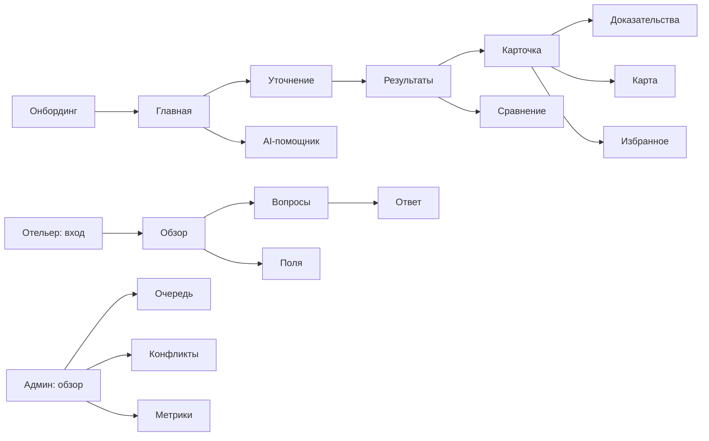

# Карта всех экранов и навигация

**Статусы разработки:** E1 = рабочая минимальная техническая версия на этапе 1; E2 = клиентский интерфейс; E3 = кабинет отельера; E4 = расширенная админка. Первый этап определяет данные и API для **всех** экранов, но не требует верстать их все.

## A. Турист / Telegram Mini App

| ID | Экран | Основное содержание | Основное действие | API / данные | Этап |
|---|---|---|---|---|---|
| T01 | Старт / Onboarding | что делает сервис, 3 сценария, согласие с ограничениями | «Начать подбор» | local+profile | E2 |
| T02 | Главная | поиск по словам, готовые сценарии, рекомендации | отправить запрос | `POST /search` | E2 |
| T03 | Уточнение запроса | география, даты, вес питомца, важность условий | подтвердить критерии | search parse | E2 |
| T04 | Результаты | выдача, соответствие условиям, unknown, оговорки | открыть карточку | search results | E2 |
| T05 | Карточка отеля | фото, карта, характеристики по категориям, объяснения | «Показать доказательства» | hotel profile | E2 |
| T06 | Доказательства признака | значение, статус, источник, дата, метод, контекст | перейти к источнику | facts/evidence | E2 |
| T07 | Сравнение | таблица 2–4 отелей, подтверждено/неизвестно/не подходит | поменять вариант | compare | E2 |
| T08 | Карта | объекты, пляжи, пешеходный маршрут, предупреждения | открыть маршрут | geo/reachability | E2 |
| T09 | Избранное | сохраненные, заметки, повторный поиск | сохранить/убрать | existing saved | E2 |
| T10 | История поиска | запросы и сохранённые предпочтения | повторить запрос | history | E2 |
| T11 | AI-помощник | диалог и уточнения, ссылки на факты | задать уточнение | existing agent/chat + search | E2 |
| T12 | Профиль / настройки | Telegram user, язык, приватность, помощь | настроить | existing profile | E2 |
| T13 | Как это работает | объяснение verified / estimated / unknown | открыть пример | static | E2 |
| T14 | Ошибка/пустая выдача | причины отказа источника/поиска и как исправить | попробовать снова | errors | E2 |

### Нижняя навигация T

`Главная → Поиск/Результаты → Избранное → Профиль`; карточка, сравнение и доказательства — вложенные. `AI-помощник` — доступный action с главной/результатов и отдельная вкладка, если позволяет мобильная компоновка.

## B. Отельер / защищённый кабинет

| ID | Экран | Содержание | Основное действие | API / данные | Этап |
|---|---|---|---|---|---|
| H01 | Вход и выбор объекта | подтверждение роли, закреплённые объекты | войти | auth/roles | E3 |
| H02 | Обзор | статус заполнения, срочные вопросы, конфликты | перейти к задаче | metrics+questions | E3 |
| H03 | Характеристики | все поля, происхождение, актуальность | подтвердить / оспорить | facts/profile | E3 |
| H04 | Вопросы агента | открытые/закрытые вопросы, приоритеты | ответить | questions | E1 (API), E3 (UI) |
| H05 | Ответ свободным текстом | черновик, извлечённые поля, неоднозначности | отправить/подтвердить | answer/extractions | E1 (API), E3 (UI) |
| H06 | История исправлений | журнал версий, кем и когда изменено | оспорить решение | audit + facts | E3 |
| H07 | Настройки объекта | контакт, политики обновления, сотрудник | обновить | hotelier settings | E3 |

### Навигация H

`Обзор → Характеристики / Вопросы / История / Настройки`. В тестовом режиме можно выбрать «демо-отельера», в production — только RBAC с закреплением объекта.

## C. Администратор / исследователь данных

| ID | Экран | Содержание | Основное действие | API / данные | Этап |
|---|---|---|---|---|---|
| A01 | Операционная панель | покрытие, качество, состояние jobs | открыть проблему | metrics/jobs | E1 (API), E4 (UI) |
| A02 | Каталог | отели, импорт, дубли, геометки | открыть объект | hotels | E1 (API), E4 (UI) |
| A03 | Карточка доказательств | всё по отелю: raw/derived/resolved | сверить источник | hotel facts | E1 (API), E4 (UI) |
| A04 | Источники | доступность, лицензия, обновление, rate limit | активировать коннектор | sources | E1 (API), E4 (UI) |
| A05 | Очередь агентов | jobs, ошибки, попытки, таймлайн | переисполнить | jobs | E1 (API), E4 (UI) |
| A06 | Конфликты | кандидаты с контекстом и авторитетностью | разрешить / оставить открытым | conflicts | E1 (API), E4 (UI) |
| A07 | Реестр признаков | типы, TTL, правила получения, версии | добавить признак | feature registry | E1 (API), E4 (UI) |
| A08 | Геоанализ | слои, геометрия, даты, доказательства | проверить расчёт | geo | E1 (API), E4 (UI) |
| A09 | Вопросы отельерам | прогресс, очереди, приоритет | поставить вопрос | questions | E1 (API), E4 (UI) |
| A10 | Качество | разметка, precision/coverage/recall | экспортировать отчёт | metrics/evaluation | E1 (API), E4 (UI) |
| A11 | Аудит | кто, когда и почему изменил | просмотреть | audit events | E4 |
| A12 | Доступы | роли, закрепления, dev-test users | назначить роль | admin/roles | E4 |

### Навигация A

`Обзор → Отели → Источники → Задачи → Конфликты → Признаки → Метрики → Настройки`. Для этапа 1 достаточно Swagger/OpenAPI + **минимального Data Inspector** без избыточного фронтенда.

## D. Техническая демозона этапа 1

| ID | Экран | Что показывает | Почему нужен |
|---|---|---|---|
| D01 | Данные отеля | значения, источники, методы, дата, raw и resolved | проверяемая глубина |
| D02 | Запуск исследования | отель + признаки → job → попытки коннекторов | видимый агентный процесс |
| D03 | Конфликты и уточнение | несовместимые поля, вопрос, ответ и итог | живой end-to-end сценарий |
| D04 | Отчёт качества | сколько подтверждено, неизвестно, конфликтов, точность на выборке | проверяемая метрика |

**Правило UX для будущего:** технические статусы `verified/estimated/reported/conflicted/stale/unknown` должны иметь отдельные описания на понятном языке; нельзя маскировать отсутствующие доказательства общей «AI уверенностью».

## Карта переходов

